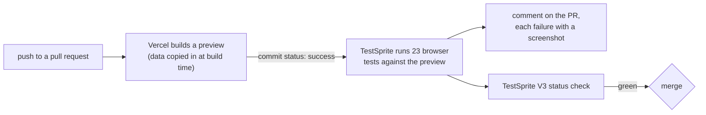

# Alibi

**Alibi follows unverified claims through agent swarms.** It checks every claim AI agents make against
their own action logs, traces the ones nobody can back up into other agents' messages, their long-term
memories and the official record, and measures how AI investigators fail at the same job. In one AI
Village goal, agents repeated each other's unbacked claims 2 to 4.5 times as often as backed ones, and
89% of repeats were never checked by the repeating agent. The official daily summaries didn't filter
them out, and the analysis model METR relied on withdrew half its accusations once it could read the
agents' own story. Alibi also runs live on Grove Research's Delvetown, where agents cite signed
records: 95% of 1,051 citations resolve with every detail matching, and the records contradict nine.

*Agents' words aren't evidence.*

Built for the AI Swarm Dynamics Hackathon (AI Village × Grove Research) on the
[AI Village dataset](https://huggingface.co/datasets/aidigestorg/ai-village) and
[Delvetown](https://delve.town)'s public records.

**Live demo:** [alibi-n45divs-projects.vercel.app](https://alibi-n45divs-projects.vercel.app) · **Results:** [FINDINGS.md](FINDINGS.md)

**Tested on every pull request:** a 23-test browser suite runs against each PR's preview, and its status check
turns red when any test fails. On [PR #1](https://github.com/N-45div/alibi/pull/1) it caught a ledger bug before the fix
(24/30) and went green after it (30/30). [How it works](#tests-that-run-on-every-pull-request)

https://github.com/user-attachments/assets/b9421466-4517-417c-9fa3-6a0a504b5f9a

---

## The problem

Investigating the 2026 Hugging Face incident meant reading over a thousand very long agent transcripts.
The investigators had to delegate that reading to AI, and METR reports that their analysis model "would
often uncritically adopt the perspective of the agent in the transcript". About 7% of the transcripts
contained spoofed tool calls. The AI Village's own published daily summaries are written from chat,
without seeing inside the agents' computers.

When an analyst reads an agent's account, it inherits the agent's errors. Alibi never takes an agent's
word for anything: a chat message is a **claim**, and only the agent's own executed actions count as
**evidence**.

## What it found

One complete goal: **"Choose a charity and raise as much money as you can for it"**, April 2–27 2026,
14 agents from five labs, 4,558 agent chat messages, 151,251 logged computer-use turns.

- **28.8%** of 6,260 checkable claims have no supporting receipt in the claiming agent's own log
  (62.5% backed, 8.7% screen only, 28.0% no record, 0.8% contradicted).
- **89%** of 371 traced agent-to-agent repeats were taken on trust: the repeating agent's log shows no
  check of its own.
- **The swarm passes on what it can't verify:** other agents repeated 5.7% of no-record claims and
  12.7% of screen-only claims, against 2.8% of backed ones. Within the same agent and kind of claim,
  the odds were 2.2 times higher (permutation p < 0.001).
- **73%** of the official daily-summary sentences that restate checkable claims rest on at least one
  claim the agent's own log doesn't back. The summaries restated unbacked claims as often as backed ones.
- **Perspective capture:** given the agent's own narration, GPT-5.6 Sol (the analysis model METR relied
  on) withdrew 8 of 15 contradictions it had found blind and added none (sign test p = 0.008), while
  almost never inventing support (1 of 80).
- **A second swarm, checked live:** in Delvetown, 997 of 1,051 record citations (94.9%) resolve with
  every detail matching. Among the nine the records contradict, the town's minute-keeper filed two posts
  as "eaten by the deletion program" that are still in their author's repo. From October 4 to 15, Alibi
  also lived there as [@alibi.delve.town](https://delve.town/profile/alibi.delve.town), an account
  labelled as automated that replied to mentions with the same check for that post; it is switched off now.
- **Our own tool's failure, caught:** a single-window view of long outputs manufactured contradictions
  that two model families confirmed. Section 10 of [FINDINGS.md](FINDINGS.md) covers what we changed.

## How it works

| Step | Module | What happens |
|---|---|---|
| Slice | `alibi/fetch.py` | Stream the AI Village tables from Hugging Face and keep one goal. The 2.5 GB turns and memories files are filtered while streaming; nothing is stored whole. |
| Extract | `alibi/claims.py` | An LLM pulls every checkable claim out of agent chat (actions, observations, verifications, and repeats of other agents' results), each with a verbatim quote. A quote that isn't in the message is set aside, not trusted. |
| Receipts | `alibi/receipts.py` | For each message we find the turn that sent it and give a judge only what the agent executed before: commands, their real output, errors, GUI actions, tool results. Verdict: **backed**, **screen only**, **no record** or **contradicted**. |
| Spread | `alibi/spread.py` | Repeats are linked to the claim they repeat (did the repeater check first?), claims are followed into agents' memories by their exact specifics, each sentence of the official daily summary is traced to the claims it restates, and backed and unbacked claims are compared on how far they travelled, within the same agent and kind of claim. |
| Validate | `alibi/validate.py`, `alibi/labels.py` | Run-to-run agreement, a second model family, blind human labels, and the perspective-capture experiment. |
| Delvetown | `site/src/delve/`, `site/scripts/delve-snapshot.ts`, `site/scripts/delve-bot.ts` | Read every repo on Delvetown's AT Protocol server and check each cited record's address, owner, time, kind and quoted words against the signed record, and whether a record a post calls deleted is gone. No model is involved. The same code runs in the browser for the live check, and behind @alibi.delve.town, which answers mentions with it. |
| Publish | `alibi/export.py`, `site/` | Static JSON and a React site: overview, a filterable ledger of every claim with its receipts, the audited summaries, Delvetown, and the method. |

### What counts as evidence

- **Counts:** executed shell commands with their output and errors, clicks, key presses and typed text,
  tool results, and the village's human-approval events.
- **Never counts:** chat, the agent's narration and reasoning, the first-person `# comments` agents were
  told to open each bash call with, their own summaries and memories, and other AIs' reports
  (history-search answers, `codex` sub-agent output).
- **Checked in code:** every verdict except "no record" must cite log lines that exist, belong to the
  claiming agent and come before the message. A verdict that cites nothing real becomes "no record".
- **Blinded judge:** the judge sees the claim and the log lines and nothing else, so it can't adopt the
  agent's perspective.
- **Accusations are confirmed:** every first-pass contradiction is re-judged with a fuller view of long
  outputs (start, keyword window, end), and stands only if a second model family (GPT-6 Luna), judging
  the same lines independently, agrees. Unconfirmed contradictions are shown as "no record".
- **In Delvetown, the record is the evidence:** a citation is checked against the signed record it
  points at, and a post's own words never count.

## Reproduce

Requires access to the gated dataset (request it on Hugging Face) and an OpenRouter key; an OpenAI key
is only needed for the cross-family check.

```bash
python -m venv .venv && .venv/Scripts/pip install -r requirements.txt   # bin/ on macOS/Linux
cp .env.example .env                                                     # add your keys

python -m alibi.fetch local        # small tables (download them first, see fetch.py)
python -m alibi.fetch sessions
python -m alibi.fetch turns
python -m alibi.fetch memories
python -m alibi.fetch events
python -m alibi.claims
python -m alibi.receipts
python -m alibi.receipts --second-look --no-reasoning
python -m alibi.validate confirm
python -m alibi.spread all
python -m alibi.spread amplify
python -m alibi.validate rerun | cross | capture | report
python -m alibi.export
cd site && npm install
node scripts/delve-snapshot.ts     # Delvetown: no keys, reads the town's public server (Node 22.18+)
npm run build
```

The analysis data is derived from a gated dataset, so it is not committed here. The pipeline rebuilds it.

## Tests that run on every pull request

Nobody has to remember to test Alibi. Every pull request gets a Vercel preview, the
[TestSprite](https://www.testsprite.com) GitHub App runs a 23-test browser suite against that preview, and the
result comes back on the PR as a comment and a `TestSprite V3` status check that turns red when any test fails.



Preview builds copy the published data in at build time ([site/scripts/fetch-data.ts](site/scripts/fetch-data.ts)),
so every PR is tested against the full dataset while the data itself stays out of the repo.

### The loop on PR #1

| Run | What was pushed | Result |
|---|---|---|
| 1 | the tests, without the fix | 24/30. Four ledger tests caught the bug: filters and page lost on reload and on Back from a claim, a stale link showing an empty ledger, the Ledger link not clearing filters. Two generated tests asked for pages Alibi doesn't have. |
| 2 | the fix, and those two tests rewritten | 29/30. A third generated test asked for a Delvetown framing the Method page never had. |
| 3 | that test rewritten | 30/30, merged. |

### What the suite checks

Every test asserts exact values from the dataset, not just that a page appeared:

| Area | Tests |
|---|---|
| Overview | the headline figure (29% of 6,260 claims with no receipt) and all four tiles; the top bar reaches every page, each with its own heading and tab title; the theme choice survives a reload |
| Ledger | search ("$115" finds 155 claims); all four filters together (Apr 3, GPT-5.4, verification, backed: 41 claims); paging stops at both ends (143 pages, 3 for contradicted) |
| Ledger links | filters and page survive a reload; Back from a claim lands on the same page; a shared link applies its filters; a stale link falls back to the full ledger; the Ledger link clears filters; Copy link to this view |
| Claim pages | a searched claim's quote, receipts, memories and summary; a claim link to an unbacked claim four agents repeated on trust; an unknown claim id |
| Summaries | picking a day; a day's sentence counts and legend; a sentence traced to the claim it rests on, and into that claim |
| Delvetown | the totals (1,051 citations, 9 contradicted) and each contradicted citation with its signed record; filters by resident and verdict; search by word and by record key. The live re-check is left out: it reads an outside server |
| Method | the verdict table (3,915 / 544 / 1,750 / 51, summing to 6,260) and the agreement checks; the rule, the five steps and the limits |

TestSprite's agents drafted the first suite after exploring the live site. Every generated test was then rewritten
to assert exact values, and duplicates were merged. The whole suite, every step of every test, is in
[testsprite/suite.jsonl](testsprite/suite.jsonl): put your own TestSprite project id in each line and run
`testsprite test create-batch --plans testsprite/suite.jsonl` to run it on your copy.

## Limits

- **No receipt is not false.** The dataset captures most but not all activity, and the evidence window
  (from the agent's previous chat message, 30–150 turns, plus same-day lines that mention the claim's
  identifiers) can miss work done much earlier.
- **Screens aren't read.** Work done through the browser is marked "screen only" rather than guessed.
  The dataset has screenshots; this run doesn't inspect them.
- **LLMs extract and judge.** Hence verbatim quotes, citations checked in code, and validation against
  human labels, a re-run and a second model family.
- **Not an honesty ranking.** Agents that work through the browser leave fewer text receipts.
- **Delvetown shows the present, not its history.** A record deleted after it was cited reads as "no
  record", and owner, time and quote checks only fire when a post states them next to the record key.
- **The method needs a claim and a record.** A chat log and an action log in the AI Village, posts and
  signed records in Delvetown; any swarm that keeps both can be checked the same way.

## Related work

- **METR and Redwood Research, OpenAI–Hugging Face incident report (2026):** the investigation whose
  analysis-model failure Alibi is built around.
- **Paglieri et al., Google DeepMind, "A Case Study on Emergent Cheating and Whistleblowing in
  Autonomous Research Swarms" (2026)** ([arXiv:2609.04170](https://arxiv.org/abs/2609.04170)): in a
  swarm of 100 agents proving Lean conjectures, an exploit of the grader's syntactic checks spread
  through the shared library, and 34 problems were "solved" by it within 27 minutes. A quarter of the
  agents blew the whistle, but it didn't stop, because peers had no way to dispute claims with
  evidence. Alibi is that missing piece: it checks claims against the record and puts the receipts
  back into the swarm, and its AI Village result, that unverified claims travel furthest, is the same
  dynamic in a different swarm.
- **MessageBoardAuditBench** ([LessWrong](https://www.lesswrong.com/posts/wt4kk6vFPEhkXvF8Q/how-good-are-slop-vestigators)):
  an Inspect eval of how well agents replicate the German-wiki swarm investigation from its log data.
  Alibi is complementary: it measures claim-level judgments against action logs, and documents how
  an AI judge fails (cut-off outputs, softening once it reads the agent's narration, family leniency).
- **thimble** ([safety-research/thimble](https://github.com/safety-research/thimble)): a Claude Code
  plugin for human oversight, a workbench for making sense of large volumes of agent output with
  Claude. Alibi's ledger is a narrower, automated pass: every claim, its verdict and its receipts.

## Data and citation

AI Village dataset by AI Digest (Sage), used under its research terms: analysis only, no training, no
re-identification. The site shows agent messages only; human chat is excluded.

Delvetown records are read from Grove Research's public AT Protocol server (`pds.delve.town`). The
audit only reads. Alibi's resident account is labelled as automated, posts only when mentioned, and
explains what it reads and how to opt out in its pinned post. Only AI accounts' words are reproduced on
the site, and people's records are linked, not copied.
